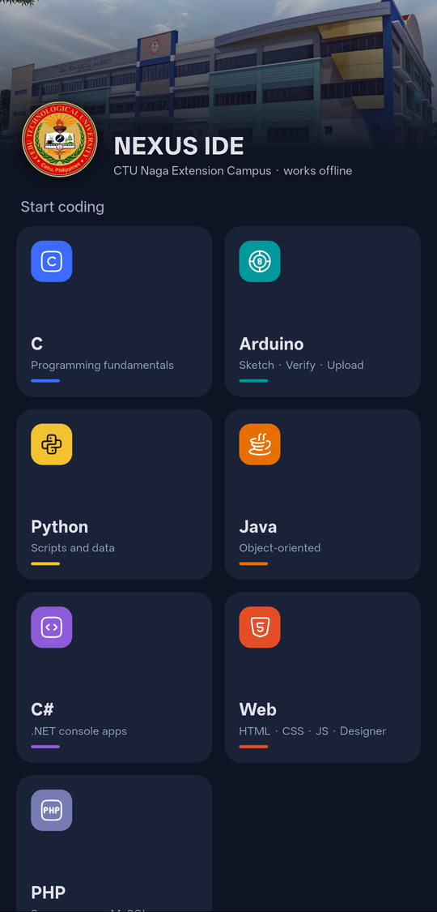
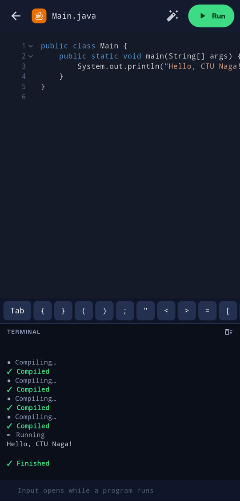
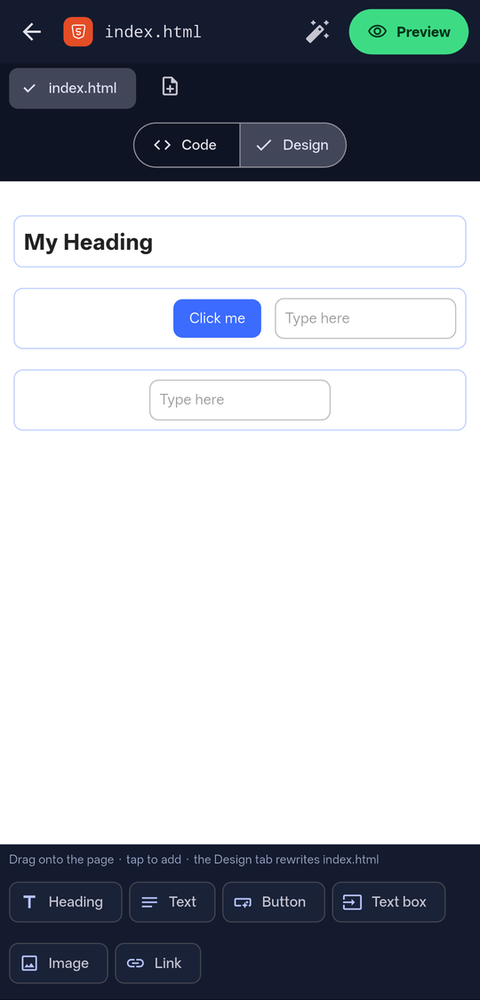
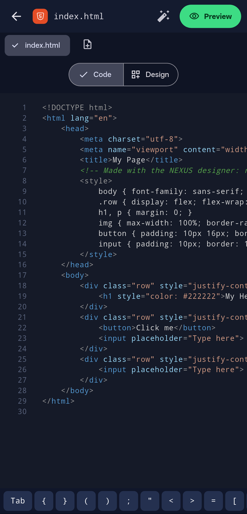

# NEXUS IDE

An offline IDE built with **Flutter** for the students of **Cebu Technological University – Naga Extension Campus**. It turns an Android phone or a shared lab PC into a programming workstation: write, compile and run code, build web pages, and program an Arduino, with no internet and no installs.

<p align="center">
  
  
  
  
  
</p>

## Download

Get the Android APK from the [latest release](../../releases/latest). It's a sideloaded app: allow "Install unknown apps" for your browser or file manager. Android 7.0+ on 64-bit ARM (almost every phone from the last few years). On first launch it unpacks its compilers, which takes about a minute.

## What it does

| Tile | Android phone | Lab PC (Windows) |
|---|---|---|
| **C** | TCC | MinGW GCC |
| **Python** | Python 3 | Embedded Python |
| **Java** | ecj compiler on Android's own Java VM | Portable JDK |
| **C#** | Mono (`mcs`) | .NET SDK |
| **Arduino** (Uno, Nano) | avr-gcc on the phone + upload over **USB OTG**, Serial Monitor | arduino-cli (also Mega 2560) |
| **Web** (HTML, CSS, JS) | Editor, **drag-and-drop designer**, in-app preview | Editor, designer, opens in the browser |
| **PHP + MySQL** | PHP built-in server + MariaDB | Portable PHP (or XAMPP) + MySQL |
| **Raspberry Pi** (GPIO simulator) | Python with a stand-in `RPi.GPIO`: LEDs and buttons in a live 40-pin panel | Same |

Also: syntax highlighting and autocomplete, a coding key bar for phone keyboards, VS Code-style auto-indent (Enter after `{` or an opening tag), a **Format** button that indents C-style code and HTML/PHP, multiple files per Web/PHP project, a terminal that only appears when a program runs, and on Windows a full-screen VS Code-style layout (language bar on the left, terminal docked on the right).

**iPhone:** Apple doesn't allow apps to run compilers, so only the Web tile can work there. An iOS build is untested.

## How it works

The Flutter UI saves the student's file, then runs real compilers as child processes and streams their output into the in-app terminal (`lib/core/runner.dart`, `run_session.dart`). Each language is one entry in the table in `lib/core/toolchains.dart`: its file name, template, and the commands for PC (`steps`) and phone (`androidSteps`).

- **Phones:** the APK ships a compiler pack (`toolchains.zip`) built from [Termux](https://termux.dev) packages, plus Alpine Linux's arm64 avr-gcc for Arduino. `targetSdk` is **28** on purpose: it's the last Android level that lets an app run programs from its own storage, so the APK is sideloaded rather than published on the Play Store.
- **Arduino upload on phones** speaks the STK500 bootloader protocol in Dart over USB OTG (`lib/core/stk500.dart`, `otg.dart`), with a patched `usb_serial` plugin in `packages/`.
- **Lab PCs:** portable toolchains sit in a `toolchains/` folder next to `nexus_ide.exe` (e.g. on a USB drive). Missing tools fall back to the same program on `PATH`.

## Build from source

Needs the Flutter SDK, the Android SDK, and Python 3.14+.

```bash
flutter pub get
python tool/build_android_toolchains.py      # downloads ~150 MB, writes android/app/src/main/assets/toolchains.zip
flutter build apk --release --target-platform android-arm64
```

The Arduino part of the pack copies the Arduino AVR core from a local arduino-cli install in `toolchains/arduino/` (see the comments in `tool/build_android_toolchains.py`).

Windows build: `flutter build windows`, then put the portable toolchains next to the exe:

```text
toolchains/
├── mingw/bin/gcc.exe       # C
├── python/python.exe       # Python (embeddable zip)
├── jdk/bin/java.exe        # Java
├── dotnet/dotnet.exe       # C# (SDK major must match nexus.csproj)
├── php/php.exe             # PHP (or PHP on PATH, e.g. XAMPP)
└── arduino/                # arduino-cli.exe + data/ with the arduino:avr core
```

Run the tests with `flutter test`.

## License

[MIT](LICENSE) © Logan M. Panucat

---
**Developed by Logan M. Panucat** · [GitHub](https://github.com/Ezgaminglogan) · [LinkedIn](https://www.linkedin.com/in/logan-panucat-b319562a9/) · [Facebook](https://www.facebook.com/Cflogan.Panucat2nd)

*Made with ❤️ for the students of Cebu Technological University – Naga Extension Campus.*
