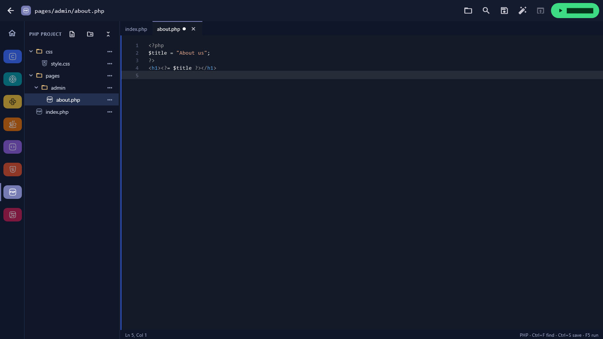
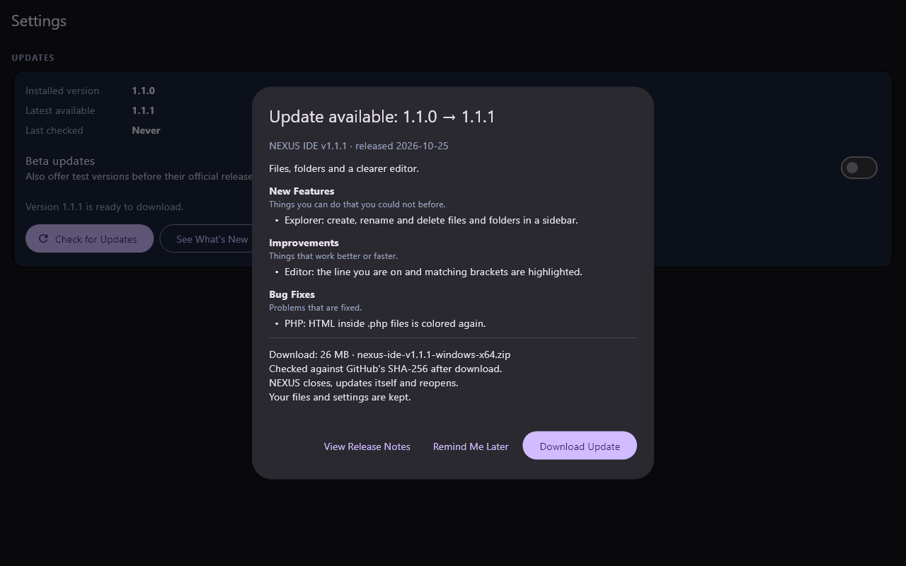
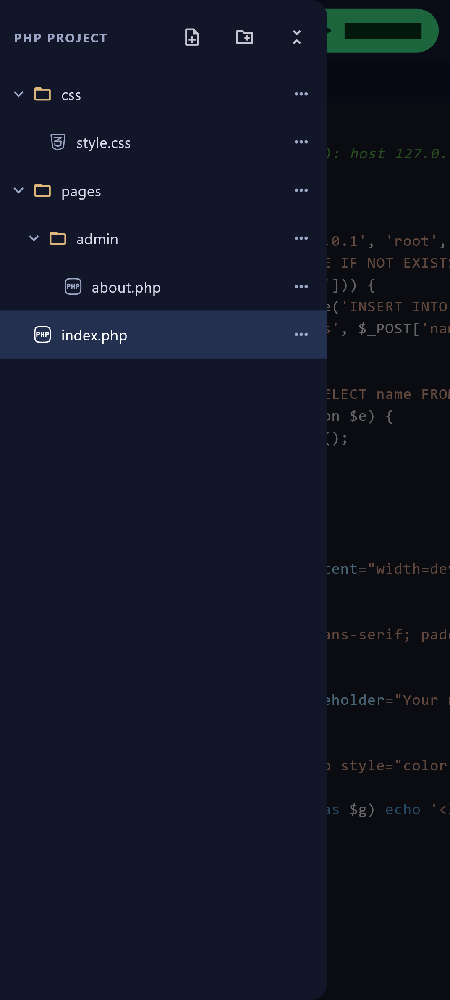
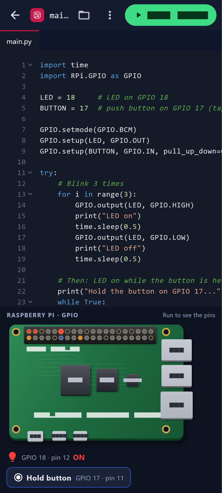

# NEXUS IDE improvements (v1.1.1)

NEXUS IDE is a Flutter app (not a web or PHP-hosted app): an Android APK for phones and a portable Windows build for lab PCs. Everything below is built on that, and runs offline except checking for updates.

## What changed

| Area | What you get |
|---|---|
| **Updates** | Settings (gear on the home screen) → Updates shows the installed version, the latest version, when it last checked, a **Check for Updates** button and a Beta switch. When a newer version exists, a dialog shows what changes and lets you download, check and install it. |
| **Project explorer** | A VS Code-style file tree for each language's project: nested folders, new file/folder (several levels at once, like `pages/admin/about.php`), rename, delete (with a warning that says how many files), open in tabs. Sidebar on PCs (hide/show button, drag the edge to resize); a drawer on phones. Visibility, width and open folders are remembered. |
| **Editor** | The line you're on is tinted; the matching bracket or HTML tag is boxed; a blue edge shows which pane has focus; brighter cursor and selection; a dot on a tab that has unsaved changes; Find (Ctrl+F or the search button) with all matches and the current one highlighted; Ln/Col status bar on PCs. `.php` files now use the HTML grammar, so the HTML is colored and `<?php … ?>` blocks are colored as PHP. |
| **Raspberry Pi** | The pin panel is now a drawn board with depth: shadow and edge thickness, a lit PCB, mounting holes, chips, USB/Ethernet/HDMI/power ports and the 40-pin header. Pins light up for outputs; input pins can be pressed on the board or with the Hold button. Hovering a pin outlines it. It's a generic Raspberry Pi-style board, not an exact model. |
| **Phones** | **Enter fullscreen** in the ⋮ menu hides Android's status and navigation bars (swipe from the edge to see them; the same menu exits). The explorer is a drawer, less-used actions sit in the ⋮ menu so the file name keeps its room, and the editor respects the safe area and the on-screen keyboard. |
| **Commands** | `dart run tool/nexus.dart <command>` for running, building and preparing releases (below). |

Run, Verify and Upload always build the language's main file (`main.c`, `index.php`, …) whichever tab is open; the open tab is saved first.

## How the updater works

- **Source:** GitHub Releases of `Ezgaminglogan/nexus-ide` (`lib/core/update.dart`, `releasesApi`). The app reads the list once a day at startup (quietly; offline is fine) and whenever you press Check for Updates.
- **Version:** `pubspec.yaml` is the only place the version lives. Flutter writes it into the APK and the exe; the app reads it back with `package_info_plus`. Versions compare as semantic versions: `1.2.0-beta.2` < `1.2.0-rc.1` < `1.2.0`.
- **Channels:** Stable ignores GitHub pre-releases (and versions like `1.2.0-beta.1`); turning on **Beta updates** includes them.
- **Which file:** Android downloads the asset ending in `-arm64.apk`; Windows the one ending in `-windows-x64.zip`. A release without one for your device shows as "no package for this device" (v1.1.0 has no Windows zip, so a PC sees exactly that today).
- **States shown:** checking, up to date, available, downloading (real percentage), checking the download, ready to install, installing, offline, failed, and no package for this device, each with Retry where it makes sense.
- **Verification:** after downloading, the file's size must match and its SHA-256 must match the `digest` GitHub publishes for every asset. A mismatch deletes the file and asks you to retry. Older assets without a digest are checked by size only.
- **Release notes:** the dialog splits the release text into New Features, Improvements, Bug Fixes and Breaking Changes (from `## …` headings), with a one-line explanation of each section. With no notes it says so and still links to the release page.
- **Install:**
  - *Android:* the verified APK is handed to Android's installer (FileProvider + `REQUEST_INSTALL_PACKAGES`); Android asks you to confirm. Updates install over the old app only when signed with the same key (currently the debug key on the build PC).
  - *Windows:* NEXUS writes a small script, closes, the script unpacks the zip over the app folder, then starts NEXUS again. This needs a writable app folder (USB drive or a user folder, not `Program Files`).
- **Your work is safe:** before installing, every open editor saves. Student files and settings live in `workspace/` (settings in `workspace/.nexus/settings.json`, downloads in `workspace/.nexus/updates/`), which an update never replaces. There is no automatic rollback; to go back, install the older release's file.
- **One dialog:** repeated checks never stack dialogs; "Remind Me Later" hides it for a day.

### Publishing a release the updater will find

1. `dart run tool/nexus.dart release:patch` (or `release:prepare` to rebuild the same version).
2. Edit `dist/RELEASE_NOTES.md`: keep the `## New Features / ## Improvements / ## Bug Fixes / ## Breaking Changes` headings you need, one `- **Name:** effect on the user` bullet per change, and delete the comments.
3. Commit and push, then publish (this is the step that makes it public):
   `gh release create v<version> dist/nexus-ide-v<version>-arm64.apk dist/nexus-ide-v<version>-windows-x64.zip --title "NEXUS IDE v<version>" --notes-file dist/RELEASE_NOTES.md`

The asset names must stay `nexus-ide-v<version>-arm64.apk` and `nexus-ide-v<version>-windows-x64.zip`.

## Commands

Run from the project folder. Needs the Flutter SDK; `build:apk` also needs the Android SDK and Python 3.14+ (only the first time, to build the phone compiler pack); `build:win` must run on Windows.

| Command | What it does | Changes files? | Commits / tags / publishes? |
|---|---|---|---|
| `dart run tool/nexus.dart dev` | `flutter run` on the connected phone (or first device) | No | No |
| `dart run tool/nexus.dart desktop` | `flutter run -d windows` (debug) | No | No |
| `dart run tool/nexus.dart build:apk` | Release APK → `dist/nexus-ide-v<version>-arm64.apk` (runs `tool/build_android_toolchains.py` first if the pack is missing) | Writes `dist/`, `build/` | No |
| `dart run tool/nexus.dart build:win` | Release Windows build, zipped → `dist/nexus-ide-v<version>-windows-x64.zip` (the portable `toolchains/` folder is not included) | Writes `dist/`, `build/` | No |
| `dart run tool/nexus.dart version:patch` | `1.1.1+3` → `1.1.2+4` in `pubspec.yaml` | `pubspec.yaml` | No |
| `dart run tool/nexus.dart release:prepare` | build:apk + build:win + `dist/RELEASE_NOTES.md` draft with commits since the last tag and SHA-256s | `dist/`, `build/` | No |
| `dart run tool/nexus.dart release:patch` | version:patch, then release:prepare | `pubspec.yaml`, `dist/`, `build/` | No |

`dist/` is git-ignored. Screenshots for this document: `flutter test tool/screenshots_test.dart`.

## Verification

Checked on this Windows PC:

- `flutter analyze`: no issues. `flutter test`: all tests pass, including new ones for version ordering (pre-releases, numeric parts), channel filtering, asset choice per platform, release-note sections, SHA-256/size verification, one-dialog-per-run, bracket and tag matching, safe workspace paths, nested create/rename/delete, explorer hide/show and remembering it, HTML+PHP highlighting, and the Pi panel.
- Live check against the real GitHub release list (installed version faked as 1.0.0): found v1.1.0 with its title, date, notes and the APK's SHA-256, and reported "no package for this device" on Windows because v1.1.0 has no Windows zip, which is correct.
- `release:patch` ran end to end: bumped to 1.1.1+3, built the APK (134.6 MB) and the Windows zip (13.5 MB), and wrote the notes draft with SHA-256s. The zip has the app files at its root, as the updater expects.
- Screenshots below are rendered with Flutter's test engine (`tool/screenshots_test.dart`) at desktop and phone sizes with real fonts; they are the real widgets, not captures of a running app. Text drawn directly on the Pi board and bold button labels show as boxes there because the test engine lacks those font weights; the app itself draws them normally. The phone render found the app bar running out of room at 412 px, which led to the ⋮ menu.

 

**Not checked yet (needs a phone, a second release, or a packaged run):**

- Installing an update for real: Android's installer flow, and the Windows close → unzip → restart script. Both need a newer published release than the installed app.
- Fullscreen and the drawer on a real phone, and the Raspberry Pi board's appearance with real fonts on the phone (the phone wasn't connected).
- Desktop screenshots of the running Windows app (the PC was in use).

## Limitations

- Inside HTML/PHP files, CSS in `<style>` and JavaScript in `<script>` stay uncolored: the `highlight` package doesn't switch grammars there. Separate `.css`/`.js` files are colored.
- Bracket matching ignores whether a bracket sits inside a string or comment.
- No error squiggles: NEXUS has no per-language analyzer; compiler errors appear in the terminal.
- Windows fullscreen is "maximized"; true borderless fullscreen would need a window-manager plugin.
- No update rollback (install the older release's file instead). Windows updating needs a writable app folder.
- The Raspberry Pi board is a generic, Pi-style drawing, not an exact model.
